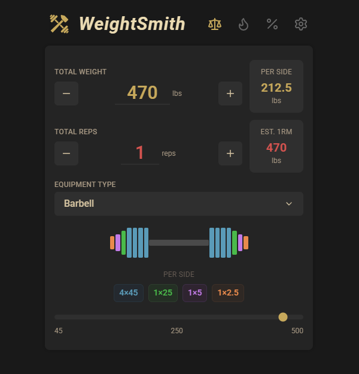

# ⚖️ WeightSmith

**[weightsmith.com](https://weightsmith.com)** — A minimal plate calculator PWA for lifters.

Built with React, TypeScript, and Tailwind CSS. Mobile-first, installable, works offline.

## Development and maintenance

Use Node.js 24 LTS (or Node.js 22.12+) and npm. Install the exact locked dependencies with `npm ci`, then run `npm run dev`.

Before releasing, run `npm audit`, `npm run lint`, `npm test`, and `npm run build`.
The deployment tests use temporary local Git repositories and never contact GitHub.

`package.json` is the source of truth for the application version. After checks pass, run
`npm version patch --no-git-tag-version` and rebuild. This updates both package manifests;
Vite injects the version into the application and the generated `dist/sw.js` cache name.
Keep the `__APP_VERSION__` placeholder in `public/sw.js` intact.

`npm run deploy -- --dry-run` builds and prepares a deployment without pushing.
`npm run deploy` builds and publishes `dist` to the `gh-pages` branch of `origin`,
using your configured Git identity and credentials. It preserves deployment history,
removes obsolete build files, and leaves the source checkout untouched.

Tailwind CSS 4 requires Safari 16.4+, Chrome 111+, or Firefox 128+.
See the [Tailwind upgrade guide](https://tailwindcss.com/docs/upgrade-guide).
TypeScript stays on 6.0 while `typescript-eslint` requires TypeScript below 6.1;
Node type definitions follow the Node.js 24 runtime.

---

## ✨ Features

### 🔢 Plate Calculator
- Visual plate loading with color-coded plates
- Barbell or machine/cable mode
- KG/LBs with automatic conversion
- Customizable available plates

### 📊 1RM & Percentages
- Estimated 1RM from weight × reps
- Percentage chart (65-100%) with RPE estimates
- Plate breakdown for any percentage

### 🔥 Warmup Generator
- Three progression styles (Methodical, Standard, Aggressive)
- Auto-calculated warmup sets
- Track completion as you go

### ⚙️ Settings
- Barbell weight options (Olympic, Women's, Technique)
- Toggle plates based on gym availability
- All preferences saved locally

---

## � Install

Visit [weightsmith.com](https://weightsmith.com) → Share → Add to Home Screen

---

## 🛠 Tech

React • TypeScript • Vite • Tailwind CSS • PWA

---

## 📜 License

Open source — free for commercial use, modification, and distribution.

